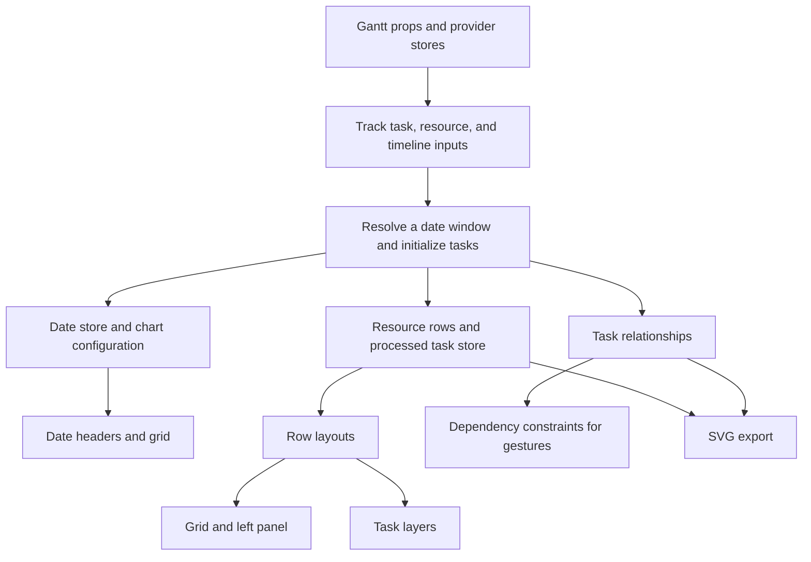

# SolidJS Gantt architecture

The Gantt chart uses stable SolidJS 2.0. State changes update the parts of the chart that read that state.

## Public API

The [package entry](../src/index.ts) exports `Gantt`, its prop types, `ColumnDef`, and the interfaces for the export API. It also exports the four store factories, context providers and hooks, constraint and hierarchy helpers, date utilities, and the data diagnostics handler.

The package ships an ES module and TypeScript declarations. It leaves `solid-js` and `@solidjs/web` external as peer dependencies. JSX compiles with `jsxImportSource: '@solidjs/web'`. A browser application must load the chart on the client.

`Gantt` accepts tasks, optional resource rows, chart options, and optional columns for the left panel. It calls `onReady` after the scroll container measures its viewport. The handle exposes `exportSvg`, `exportSvgBlob`, and `exportPng`.

## Chart setup and rendering



[`Gantt.tsx`](../src/components/Gantt.tsx) uses stores from the nearest `GanttProvider` if one exists. Otherwise, it creates its own. `Gantt` always creates a local selection store.

The setup effect tracks its inputs in its compute function. Solid store inputs become plain snapshots, so edits to nested data reach setup. The apply function passes the selected date window and geometry into [`initializeTasks`](../src/utils/ganttSetup.ts).

A nonempty `resources` prop takes precedence over provider resources. If neither supplies rows, setup derives them from the effective tasks. The effective tasks are the input tasks after `options.filter`. A search changes bar emphasis and leaves task geometry in place.

A task or filter change recalculates the date window. A scale change projects existing dates onto the new number of pixels per time unit. Setup passes this window directly to task processing. It also mirrors the window into chart configuration.

The processor assigns resource rows, calculates bar positions, and builds relationships. Setup builds the task hierarchy, recalculates summary bounds, and applies collapse visibility before writing the task store.

The chart uses a CSS grid with a corner header, date headers, a resource panel, and a scroll area. Inside the scroll area, an SVG draws the grid and an HTML layer draws bars. The full task layer renders regular bars, summaries, and expanded task containers. The minimal task layer renders lightweight bars for performance experiments.

### Resources and columns

Each displayed resource has one row. Resource group rows have their own header and can collapse their member rows. [`ResourceColumn`](../src/components/ResourceColumn.tsx) and [`ColumnPanel`](../src/components/ColumnPanel.tsx) use the same row layout as the SVG grid. Row positions are local to the scroll area.

When custom columns are present, the panel width is the sum of their widths. Otherwise, `options.resourceColumnWidth` controls the width and defaults to 120 pixels.

`ColumnDef.render(task, resourceId)` receives the first task for the resource, or `undefined`. It returns a JSX element, a string, a number, `null`, or `undefined`. The render callback runs in a tracking scope and must only compute its result. Keep store writes and requests in event handlers.

### Virtualization and scrolling

Virtualization limits rendering to the visible range and a margin around it. The margin is called overscan.

| Range from [`createVirtualViewport`](../src/utils/createVirtualViewport.ts) | Consumers                                |
| --------------------------------------------------------------------------- | ---------------------------------------- |
| `colRange()`                                                                | Date headers                             |
| `rowRange()`                                                                | Grid, resource panel, task layers        |
| `xRange()`                                                                  | Horizontal filtering in both task layers |

`Gantt` reads `overscanCols`, `overscanRows`, and `overscanX` when it creates the viewport. It defaults to five columns, five rows, and 600 horizontal pixels. The viewport uses the sorted row layouts when available, so expanded rows can have different heights.

[`GanttContainer`](../src/components/GanttContainer.tsx) synchronizes the sticky panels from DOM scroll positions immediately. It throttles the scroll signals that drive virtualization. A `ResizeObserver` updates viewport size. Imperative export reads current DOM scroll offsets and viewport size.

[`useTaskVirtualization`](../src/hooks/useTaskVirtualization.ts) groups processed tasks by resource, then filters the visible rows and horizontal range. Normal content changes update the grouping through `taskStore.contentRevision()`. Bar geometry edits during a drag update individual store leaves.

The full layer reuses regular and summary slots with `<For keyed={false}>`.
Its expanded layer keys by task ID. Date headers and grid rows use explicit
keys so overlapping entries keep their DOM nodes as the viewport moves.
Each chart has its own SVG pattern for vertical grid lines.

The [sparse slot test](../tests/forPooling.test.tsx) compares a four-slot
`For` pool with `Repeat` reading the same array by index. Both keep all four
DOM nodes. When three slots change, `For` reads three items again and
`Repeat` reads all four. The full layer uses `For`.

### Dependency arrows

[`Arrow`](../src/components/Arrow.tsx) draws an individual dependency in component demos. [`ArrowLayerBatched`](../src/components/ArrowLayerBatched.tsx) groups dependency lines and heads into SVG paths for the performance isolate. Its spatial index tracks endpoint positions. The viewport selects from the index, and the component reuses paths until endpoints or arrow geometry change.

The main `Gantt` maintains relationships for constraints, the task detail modal, and SVG export. Its live chart SVG draws the grid.

## Solid 2 reactivity

Solid stages writes until a flush commits them. A reader called immediately after a write returns the previous committed value. Functional updaters compose against the staged value.

```ts
import { createGanttConfigStore } from 'ganttss';

const config = createGanttConfigStore({ columnWidth: 45 });

config.setColumnWidth((width) => width + 5);
config.setColumnWidth((width) => width + 10);
config.getConfig().columnWidth; // 45 before the scheduled flush

queueMicrotask(() => {
    config.getConfig().columnWidth; // 60
});
```

Configuration setters return `void`. Internally they update a draft. A draft is the writable view that sees staged state. The effect or event that builds data passes it on directly when the next step needs it in the same turn.

```tsx
createEffect(
    () => props.visibleTaskIds.map((id) => id),
    (ids) => {
        taskStore.collapseAllTasks(ids);
    },
);
```

Effect compute functions track reads and produce plain values. Effect apply functions run untracked and can write state. Component bodies and compute functions cannot perform ordinary writes. `onSettled` runs untracked after mount. Its body can return cleanup and cannot create reactive primitives.

The container measures before scheduling `onContainerReady` in a microtask. That callback publishes the container API and calls public `onReady`. Disposal suppresses pending readiness, disconnects the resize observer, and clears the scroll timer.

## Stores

| Store                                              | State and behavior                                                                                         |
| -------------------------------------------------- | ---------------------------------------------------------------------------------------------------------- |
| [Tasks](../src/stores/taskStore.ts)                | Stores processed tasks by ID and the geometry of each bar.                                                 |
| [Configuration](../src/stores/ganttConfigStore.ts) | Holds chart options and expansion state.                                                                   |
| [Dates](../src/stores/ganttDateStore.ts)           | Holds the date window, column width, view mode, and date labels. Converts between dates and X coordinates. |
| [Resources](../src/stores/resourceStore.ts)        | Holds configured resources, chart display rows, group collapse state, and display indices.                 |
| [Selection](../src/stores/selectionStore.ts)       | Holds the IDs selected by click or rectangle. Each chart owns its selection.                               |

`taskStore.updateTasks` builds a task map and passes a `reconcile` draft function to the setter. `reconcile` updates the store to match the supplied map. Direct geometry changes use draft writes to fields such as `task._bar.x`. This limits drag updates to readers of the changed fields.

`ganttConfig.expandedTasks()` is a signal that holds an immutable `Set`. Its mutators replace the set. Task collapse, resource group collapse, and selection also replace their sets. Consumers must use the store methods to change these sets.

The date methods `setupDates`, `changeViewMode`, `extendTimeline`, and `setColumnWidthOverride` return the window they calculate. `changeViewMode` returns `undefined` for an unknown name. `Gantt` uses the returned window when setup runs in the same turn.

`GanttProvider` owns a set of stores for its descendants. It updates its configured resource list when its resource prop changes. `useGanttStores()` returns `undefined` outside its provider. `useGanttEvents()` returns handlers that do nothing outside its provider.

```tsx
<GanttProvider resources={resources()}>
    <Gantt tasks={tasks()} options={{ viewMode: 'Week' }} />
</GanttProvider>
```

## Interactions and constraints

[`useDrag`](../src/hooks/useDrag.ts) listens for pointer movement and release through document mouse events. It transforms client coordinates through the current chart SVG when one exists. Animation frames process the latest queued move.

A mouse release processes the final pending move and calls `flush()` before
ending the gesture. Drag state also lives in local variables so a release in
the same turn can see the active gesture. Regular and summary bar gestures
capture the task ID at mousedown. A viewport change can reuse the DOM slot
without changing the target of the gesture. `useBarDrag` reports geometry
and progress from the data it calculated. Disposing the hook removes
listeners and cancels the frame.

[`TaskLayer`](../src/components/TaskLayer.tsx) builds the relationship index and routes constraints to the relevant gesture. Regular moves can batch-move downstream tasks. Resize completion checks successors against the proposed width. [`constraintEngine.ts`](../src/utils/constraintEngine.ts) contains the lock, absolute date, and FS, SS, FF, and SF dependency rules.

Plain click replaces the selection. Shift-click adds a task. Ctrl-click or
Command-click toggles it. Dragging from empty space selects bars that
intersect the rectangle at release. Simple mode excludes child tasks from
box selection because it does not draw them. Modifier keys at the start of
the gesture extend the selection. `onSelectionChange` receives a copy of
the selected IDs.

Hover and click details use [`useGanttModals`](../src/hooks/useGanttModals.ts), which derives task and geometry data from the active task ID. Consumers can disable the built-in hover popup and click modal independently.

For the row calculations used by expanded tasks, see [Subtasks](./SUBTASKS.md). For application storage outside the chart package, see [Database architecture](./DATABASE.md).

## Development and test gates

Use a supported [development Node version](../README.md#development) and the pnpm version in [`package.json`](../package.json). Run `pnpm install`, then `pnpm dev`. The demo index is at `/examples/` on the Vite server. The DB demo also needs a seeded database and the Hono server. See [Database architecture](./DATABASE.md).

```bash
pnpm typecheck
pnpm lint
pnpm prettier-check
pnpm test
pnpm build
pnpm build:demo
```

`pnpm build` writes the library and declarations to `dist/`. `pnpm build:demo` writes the selected performance pages to `dist-demo/`. The Vite dev server serves the full set of HTML examples.

Vitest has a jsdom client project and a Node server project. Client tests use [`mountGantt`](../tests/helpers/mountGantt.tsx) for real chart mounts with simulated scroll geometry and SVG coordinate transforms. Use `settle()` after state writes and before assertions that read committed state. Await a microtask for mount readiness.

The helper allows one live chart at a time because it installs shared DOM stubs and reads development chart stores from `window`. The November audit also exercised two charts in Chrome, native resize and scroll behavior, and a separate application that installed the packed chart.

The [diagnostics gate](../tests/diagnostics.gate.test.tsx) records Solid development diagnostics during tested interactions. A browser sweep exercises actual layout and demo paths. Look for `REACTIVE_WRITE_IN_OWNED_SCOPE`, `STRICT_READ_UNTRACKED`, and `UNSTABLE_LIST_IDENTITY`. The library's `setDiagnosticHandler` reports task validation through its own channel.

See [Agent instructions](../AGENTS.md) for the full Solid 2 rules. See [Performance](./PERFORMANCE.md) for measurement history.
